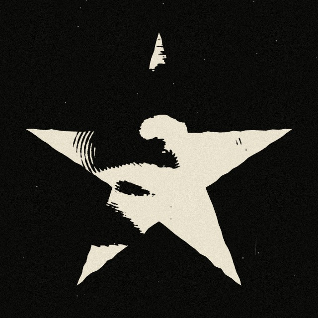
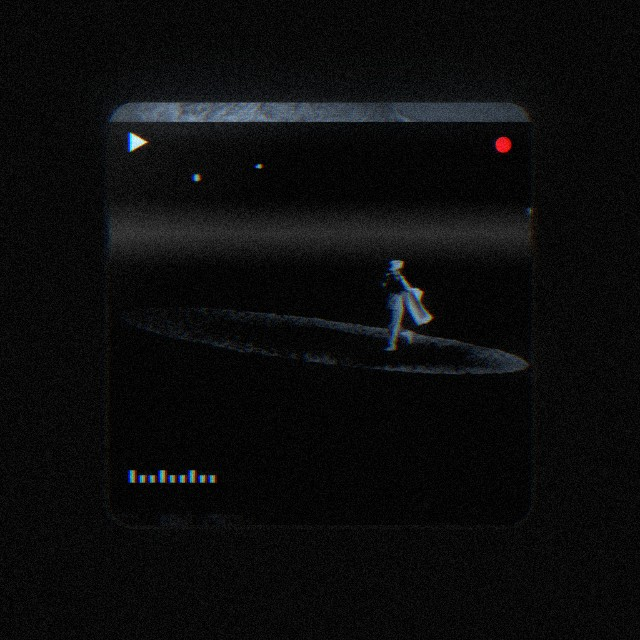
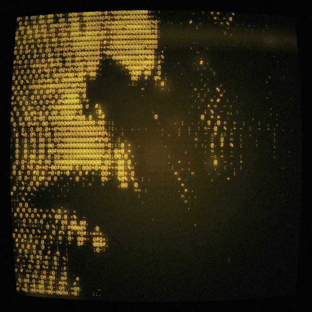
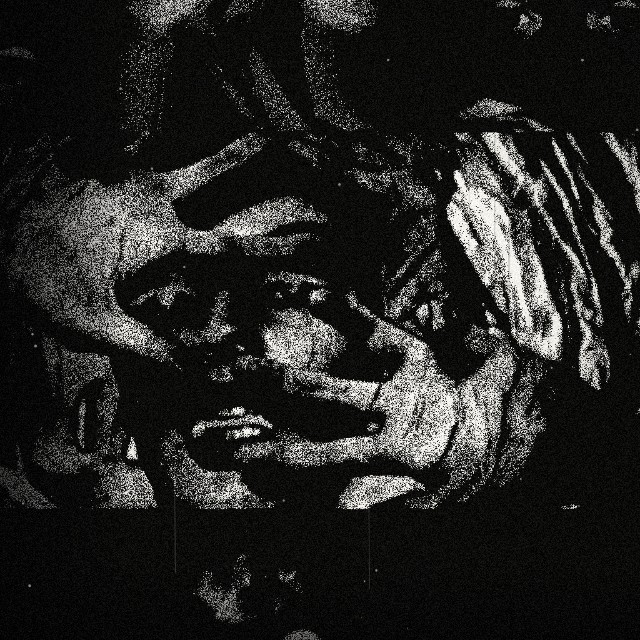
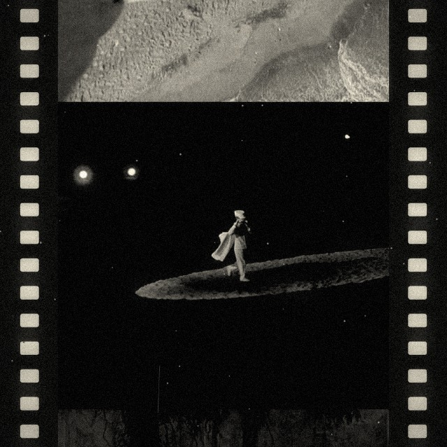

# Cover Lab

By [donovan](https://donovan-website.vercel.app/) · source: https://github.com/daywave/cover-maker

A small local tool for making **playlist covers**: image only, no text. You bring photos and a taste; it gives you black stars, old tubes, photocopies, phosphor ASCII and film stills, all with grain, dust and glow.

Everything runs on your machine. Nothing is uploaded anywhere.

## Examples

Five covers made with **Surprise me**, one per look. Each one is a different style, photo and grain, and every cover is image only.

| | | | | |
|---|---|---|---|---|
|  |  |  |  |  |
| Star | Screen | Terminal | Xerox | Still |

## Run it

Needs only **Python 3** (standard library, nothing to install) and a browser (Chrome, Brave or Edge work best).

```bash
python3 server.py
```

It opens http://localhost:8765. On macOS you can also double-click **`Cover Lab.command`**.

A local server is needed because browsers refuse to save a canvas that contains images opened straight from disk.

## The five looks

| Look | What it makes |
|---|---|
| **Star** | A photo or portrait cut into a rough-edged star. Presets: blackstar, bone, negative, blood, blue, ziggy (red and blue bolt), gray. |
| **Screen** | A still on a small old tube in the dark: scanlines, glow, play and rec symbols, phosphor colours. |
| **Xerox** | A photocopy: halftone dots, misregistration, copier shadow, tape. |
| **Terminal** | Your photo drawn in phosphor characters (dots, blocks or slashes) on a curved tube. |
| **Still** | A full-bleed film frame: letterbox, contact-print border, 16mm sprockets or porthole. |

Every look has presets and sliders. **Finish** adds grain, dust and scratches, vignette, bloom, RGB split and tube curve to any of them.

## Using it

- **Surprise me** (`S`) picks a look, a photo and a mood. **Reroll grain** (`R`) keeps the look and changes the texture. **Contact sheet** shows eight at once; click one to edit it.
- **Download JPG 640** (`D`) is the size Spotify wants. **PNG 1024** is the full-size version. **Save to exports/** writes into the `exports/` folder.
- **Panels** can be resized by dragging their borders; double-click a border to reset it.

### Photos

Drop, paste or pick photos and they are saved into the `inspo/` folder. Hover a photo to rename (✎) or delete (×). **Select** lets you pick several. Deleting moves files to `trash/`, never erases them, and the **trash** list under the photos restores them.

### Mood lines

Your own sentences steer the cover without ever appearing on it. Every line has a **mood**: *sad, tender, angry, nostalgic, lonely* or *dreamy*.

- **Where the mood comes from:** the one you tag (click the colored dot on a line to cycle through them), otherwise one read from the words (for example "recuerdo" reads as nostalgic, "extraño" as sad, "luz" as dreamy), otherwise a repeatable pick. The small label under each line says which.
- **What the mood does:** it chooses the look and preset, the colors, how much grain, dust and bloom there is, and whether the photo is a dark or a light one.
- **Repeatable:** clicking the same line gives the same cover. **Random line** and **Surprise me** use a fresh seed.
- **Manage them:** add (Enter), paste several at once, edit, delete with undo, search, and filter by mood with the chips.
- The words are **never printed** on the cover. The shipped lines are Spanish starters; replace them with yours.

### Moving around

**Surprise me** keeps a history: use the ‹ › buttons or the left and right arrow keys to step back to a cover you liked. **Reset style** and **Reset all** put the sliders back (with undo). Sections in the side panels collapse, and the panel borders can be dragged.

## Folders

```
index.html   the interface
app.js       the drawing engine and the interface logic
server.py    tiny local server (photo library, trash, saving exports)
inspo/       your photos (git-ignored; add your own)
exports/     covers you saved (created on first save, git-ignored)
trash/       deleted photos (created on first delete, git-ignored)
activity.log every add/delete/rename the server handled (git-ignored)
```

## Notes

- The server only listens on `127.0.0.1`, so other machines on your network cannot reach it.
- Photos you put in `inspo/` are not part of the repository on purpose. Check that you have the right to share any image before publishing it.
- Settings, your lines and panel sizes are kept in your browser's local storage, so they stay with that browser.
- No licence has been chosen yet. Add a `LICENSE` file before others reuse the code.
